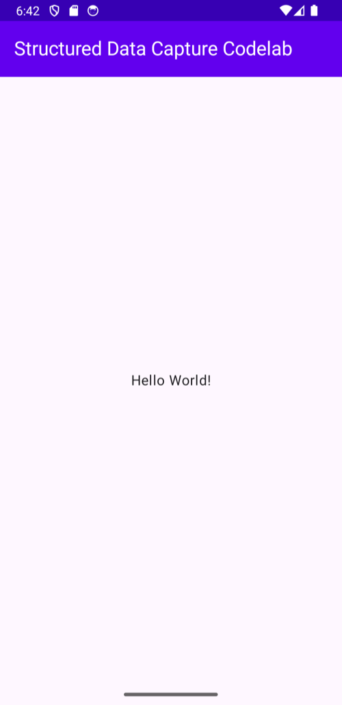
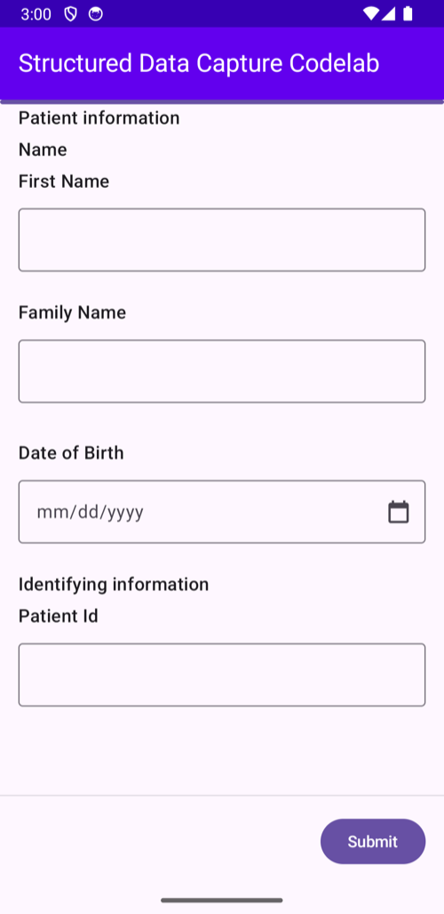

## Step 1 · Before you begin

### What you will build

In this codelab, you build a Kotlin Multiplatform app with the Kotlin FHIR Data Capture library. Your app uses the library to render and process FHIR Questionnaires and responses. The same code runs on Android, iOS, Desktop (JVM) and Web (Wasm and JS).

### What you will learn

- How to integrate Kotlin FHIR Data Capture into your Kotlin Multiplatform application
- How to display a Questionnaire
- How to get answers as a QuestionnaireResponse
- How to extract FHIR resources from a QuestionnaireResponse

### What you will need

- A recent version of [Android Studio](https://developer.android.com/studio)
- The [Android Emulator](https://developer.android.com/studio/run/emulator) or a physical Android device
- A Mac with [Xcode](https://developer.apple.com/xcode/) if you also want to run the iOS app
- The sample code
- Basic knowledge of Kotlin and [Jetpack Compose](https://developer.android.com/compose)

This codelab is focused on [Kotlin FHIR Data Capture](https://github.com/ohs-foundation/kotlin-fhir-data-capture). Concepts and code that are not relevant to the library are glossed over and provided for you to copy and paste. If you have not built a Kotlin Multiplatform app before, start by [creating your first Compose Multiplatform app](https://www.jetbrains.com/help/kotlin-multiplatform-dev/compose-multiplatform-create-first-app.html).

## Step 2 · Get set up

### Download the code

You only need the `codelabs` folder of the Kotlin FHIR Data Capture repository. You can fetch just that part of the repository with a [sparse checkout](https://git-scm.com/docs/git-sparse-checkout), which needs Git 2.25 or later.

```shell
git clone --depth 1 --filter=blob:none --sparse https://github.com/ohs-foundation/kotlin-fhir-data-capture.git
cd kotlin-fhir-data-capture
git sparse-checkout set codelabs gradle
```

The `gradle` folder is needed too, because the codelab reads its library versions from `gradle/libs.versions.toml` at the root of the repository.

Alternatively, clone the whole repository.

```shell
git clone https://github.com/ohs-foundation/kotlin-fhir-data-capture.git
```

The starter project for this codelab is in `codelabs/`.

### Project structure

| Module | Contents |
| --- | --- |
| `shared` | The `App()` composable and the questionnaire, in `commonMain` |
| `androidApp` | Android entry point |
| `desktopApp` | Desktop (JVM) entry point |
| `webApp` | Web entry point for Wasm and JS |
| `iosApp` | Xcode project that shows `App()` through `MainViewController()` |

The platform modules are only entry points. Everything you write in this codelab goes into two files of the `shared` module.

- `shared/build.gradle.kts`
- `shared/src/commonMain/kotlin/dev/ohs/fhir/codelab/App.kt`

Each place you change is marked with a numbered comment, such as `// 4 Replace with code from the codelab to display the questionnaire.` The number tells you which step of the codelab adds the code.

The questionnaire is stored as a [Compose Multiplatform resource](https://www.jetbrains.com/help/kotlin-multiplatform-dev/compose-multiplatform-resources.html) at `shared/src/commonMain/composeResources/files/questionnaire.json`, so every platform can read it.

### Import the app into Android Studio

Open Android Studio, select **Open** and choose the `codelabs` folder from the code you downloaded.

### Run the starter app

Connect your Android device to your computer over USB, or [start the Android Studio emulator](https://developer.android.com/studio/run/emulator). Select the `androidApp` run configuration and click **Run** in the Android Studio toolbar. You can also install the app from the command line.

```shell
./gradlew :androidApp:installDebug
```



There is not much here yet, so the next steps add a questionnaire to your app.

### Run the app on other platforms

Because the app is built with Kotlin Multiplatform, you can run it on other platforms too, at any step of the codelab.

| Platform | Command or action |
| --- | --- |
| Desktop (JVM) | `./gradlew :desktopApp:run` |
| Web (Wasm) | `./gradlew :webApp:wasmJsBrowserDevelopmentRun` |
| Web (JS) | `./gradlew :webApp:jsBrowserDevelopmentRun` |
| iOS | Open `iosApp/iosApp.xcodeproj` in Xcode and click **Run** |

On iOS, Xcode builds the `shared` framework with Gradle. To run on a real device, follow the [iOS app instructions](https://github.com/ohs-foundation/kotlin-fhir-data-capture/blob/main/codelabs/iosApp/README.md).

## Step 3 · Add Kotlin FHIR Data Capture to the project

### Add the dependency

Add the following line below the `// 3 Add the dependency for Kotlin FHIR Data Capture` comment in the `commonMain` dependencies of `shared/build.gradle.kts`.

```kotlin
kotlin {
  sourceSets {
    commonMain.dependencies {
      // ...

      // 3 Add the dependency for Kotlin FHIR Data Capture
      implementation("dev.ohs.fhir:fhir-data-capture:2.0.0-alpha05")
    }
  }
}
```

Because the dependency is in `commonMain`, Gradle picks the right artifact for each target platform. The `androidApp`, `desktopApp` and `webApp` modules get the library through their dependency on `shared`.

The starter project already includes the [Kotlin FHIR](https://github.com/ohs-foundation/kotlin-fhir) model and `kotlinx-serialization-json`, which you use later in the codelab.

### Sync your project with Gradle files

Select **Sync Project with Gradle Files** from the Android Studio toolbar so that all dependencies are available to your app. You can also run the app again to check that the dependencies resolve.

## Step 4 · Display a Questionnaire

In this step, you render a questionnaire in the starter app with the `Questionnaire` composable.

Open `shared/src/commonMain/kotlin/dev/ohs/fhir/codelab/App.kt`. The `App()` composable already reads the questionnaire JSON from the resources into `questionnaireJson`, and creates a coroutine `scope` that you use later in this step.

```kotlin
var questionnaireJson by remember { mutableStateOf<String?>(null) }
LaunchedEffect(Unit) {
  questionnaireJson = Res.readBytes("files/questionnaire.json").decodeToString()
}
val scope = rememberCoroutineScope()
```

Along the way, Android Studio prompts you to add these imports.

- `dev.ohs.fhir.datacapture.Questionnaire`
- `dev.ohs.fhir.datacapture.QuestionnaireConfig`
- `kotlinx.coroutines.launch`

### Add the Questionnaire composable

The `Questionnaire` composable renders a JSON encoded FHIR Questionnaire. You do not need to know the structure of a FHIR Questionnaire, or anything about FHIR, to render one. You look more closely at `questionnaire.json` later in the codelab.

1. Find the `// 4 Replace with code from the codelab to display the questionnaire.` comment in `App()`.
2. Delete the `Text(...)` line below the comment, because you no longer need the Hello World text. You can also delete the `androidx.compose.ui.Alignment` import, which is no longer used.
3. Add the following code in its place.

   ```kotlin
   // 4 Display the questionnaire
   questionnaireJson?.let { questionnaireJson ->
     Questionnaire(
       questionnaireJson = questionnaireJson,
       config = QuestionnaireConfig(showCancelButton = false),
       onSubmit = {},
       onCancel = {},
     )
   }
   ```

The questionnaire appears as soon as `questionnaireJson` has been read. `QuestionnaireConfig` customizes how the questionnaire is displayed. Here it hides the **Cancel** button, so only the **Submit** button is shown and `onCancel` can stay empty.

Click **Run** in the Android Studio toolbar. You should see something similar to this screen.



Move through the questionnaire and enter some answers. The library picks a widget for each question, such as a text field or a date picker, from the answer type in the FHIR Questionnaire.

That is all you need to render a questionnaire.

### Handle the Submit button

Nothing happens yet when you tap **Submit**. The library calls `onSubmit` when the button is tapped, so replace `onSubmit = {},` with the following code.

```kotlin
onSubmit = { getQuestionnaireResponse ->
  // getQuestionnaireResponse() validates the answers first. If validation fails, the
  // library shows an error dialog and cancels this coroutine.
  scope.launch { submitQuestionnaire(questionnaireJson, getQuestionnaireResponse()) }
},
```

`getQuestionnaireResponse` is a suspend function, so it is called from a coroutine launched in `scope`. It validates the answers before it returns the response. If any answers are invalid, the library shows a dialog that lists them and cancels the coroutine, so you do not have to handle validation errors yourself.

The response is passed to `submitQuestionnaire()` at the end of `App.kt`, which is still empty. You fill it in over the next two steps.

Your `App()` composable should now look like this.

```kotlin
@Composable
fun App() {
  val darkTheme = isSystemInDarkTheme()
  MaterialTheme(colorScheme = if (darkTheme) darkColorScheme() else lightColorScheme()) {
    Scaffold(topBar = { AppBar(darkTheme) }) { innerPadding ->
      Box(
        modifier = Modifier.fillMaxSize().padding(innerPadding).consumeWindowInsets(innerPadding)
      ) {
        var questionnaireJson by remember { mutableStateOf<String?>(null) }
        LaunchedEffect(Unit) {
          questionnaireJson = Res.readBytes("files/questionnaire.json").decodeToString()
        }
        val scope = rememberCoroutineScope()

        // 4 Display the questionnaire
        questionnaireJson?.let { questionnaireJson ->
          Questionnaire(
            questionnaireJson = questionnaireJson,
            config = QuestionnaireConfig(showCancelButton = false),
            onSubmit = { getQuestionnaireResponse ->
              // getQuestionnaireResponse() validates the answers first. If validation fails, the
              // library shows an error dialog and cancels this coroutine.
              scope.launch { submitQuestionnaire(questionnaireJson, getQuestionnaireResponse()) }
            },
            onCancel = {},
          )
        }
      }
    }
  }
}
```

## Step 5 · Get a Questionnaire Response

In this step, you read the answers from the questionnaire as a QuestionnaireResponse.

Along the way, Android Studio prompts you to add the `kotlinx.serialization.json.Json` import.

### Configure the JSON encoder

Find the `// 5.1 Replace with code from the codelab to configure the JSON encoder.` comment above `App()` and replace it with the following code.

```kotlin
// 5.1 Configure the JSON encoder
private val json = Json {
  explicitNulls = false
  encodeDefaults = false
}
```

The Kotlin FHIR model classes are `kotlinx.serialization` classes, so a `Json` instance can encode them to JSON and decode them back. `explicitNulls = false` and `encodeDefaults = false` leave out empty fields, so the output looks like regular FHIR JSON.

### Print the questionnaire response

Find the `submitQuestionnaire()` function and replace the `// 5.2 Replace with code from the codelab to print the questionnaire response.` comment with the following code.

```kotlin
// 5.2 Print the questionnaire response
println("response: ${json.encodeToString(questionnaireResponse)}")
```

The `questionnaireResponse` passed to `submitQuestionnaire()` is a Kotlin FHIR `QuestionnaireResponse`, which you can use directly or with other Kotlin FHIR libraries. This codelab encodes it to a JSON string so that you can read it in the log. The `println` output appears in Logcat on Android, the Xcode console on iOS, the terminal on Desktop and the browser console on Web.

Run the app, answer the questions and tap **Submit**. Search Logcat for `response:` to see the QuestionnaireResponse.

## Step 6 · Extract FHIR resources from a QuestionnaireResponse

The questionnaire in the starter project is a simple patient registration flow, so you will likely want to turn its answers into a [FHIR Patient resource](https://www.hl7.org/fhir/R4/patient.html). Converting a questionnaire response into FHIR resources is called [data extraction](https://hl7.org/fhir/uv/sdc/STU4/extraction.html), and the `TemplateExtractionEngine` class of Kotlin FHIR Data Capture does it for you.

### How the questionnaire describes extraction

A questionnaire must be authored with the information needed to extract data from it. The sample questionnaire is set up for [template-based extraction](https://hl7.org/fhir/uv/sdc/STU4/extraction.html#template-extract). If you open `questionnaire.json`, you find the following parts.

- A `Patient` resource with the ID `patient-template` in the `contained` array. This is the template for the extracted resource.
- An `sdc-questionnaire-templateExtract` extension on the questionnaire, which points to the template with `#patient-template`.
- An `sdc-questionnaire-templateExtractValue` extension on each template field that comes from an answer. It holds a FHIRPath expression that picks the answer, such as this one for the family name.

  ```
  %resource.repeat(item).where(linkId='PR-name-family').answer.value.first()
  ```

- Template fields without an extension, such as the identifier `system`, which are copied to the extracted resource unchanged.

The questionnaire also has `definition` elements and an `sdc-questionnaire-itemExtractionContext` extension. These are for [definition-based extraction](https://hl7.org/fhir/uv/sdc/STU4/extraction.html#definition-extract), which the library does not support, so they are ignored.

### Extract a Patient resource

Along the way, Android Studio prompts you to add the `dev.ohs.fhir.datacapture.extraction.template.TemplateExtractionEngine` import.

You also need the Kotlin FHIR `Questionnaire` model class. It has the same name as the `Questionnaire` composable from step 4, so add its import by hand with an alias.

```kotlin
import dev.ohs.fhir.model.r4.Questionnaire as FhirQuestionnaire
```

Find the `submitQuestionnaire()` function and replace the `// 6 Replace with code from the codelab to extract FHIR resources from the questionnaire response.` comment with the following code.

```kotlin
// 6 Extract FHIR resources from the questionnaire response
val questionnaire = json.decodeFromString<FhirQuestionnaire>(questionnaireJson)
val bundle = TemplateExtractionEngine.extract(questionnaire, questionnaireResponse)
println("extraction result: ${json.encodeToString(bundle)}")
```

`TemplateExtractionEngine.extract()` takes a Kotlin FHIR Questionnaire, which you create by decoding the questionnaire JSON string, and the QuestionnaireResponse from the previous step. It returns a transaction [Bundle](https://www.hl7.org/fhir/R4/bundle.html) with the extracted resources. In this case the Bundle holds a single Patient resource.

Your `submitQuestionnaire()` function should now look like this.

```kotlin
private fun submitQuestionnaire(
  questionnaireJson: String,
  questionnaireResponse: QuestionnaireResponse,
) {
  // 5.2 Print the questionnaire response
  println("response: ${json.encodeToString(questionnaireResponse)}")

  // 6 Extract FHIR resources from the questionnaire response
  val questionnaire = json.decodeFromString<FhirQuestionnaire>(questionnaireJson)
  val bundle = TemplateExtractionEngine.extract(questionnaire, questionnaireResponse)
  println("extraction result: ${json.encodeToString(bundle)}")
}
```

Run the app, submit the questionnaire and search Logcat for `extraction result:` to see the Bundle.

## Step 7 · Congratulations

You have used Kotlin FHIR Data Capture to process FHIR questionnaires and responses in your app. You can now do the following.

- Display a Questionnaire
- Get a Questionnaire Response
- Extract FHIR resources from a QuestionnaireResponse

### What you covered

- How to add Kotlin FHIR Data Capture to your Kotlin Multiplatform app
- How to use the `Questionnaire` composable and `TemplateExtractionEngine` to work with FHIR questionnaires

## Where to go next

- Run the codelab on Desktop, Web and iOS.
- Customize how rendered questionnaires look and behave with `QuestionnaireConfig`, as described in [Control rendering behavior](/fhir-foundations/kotlin-fhir-data-capture/render-a-questionnaire/).
- Read the [conformance statement](https://github.com/ohs-foundation/kotlin-fhir-data-capture/blob/main/docs/conformance.md) to see which Questionnaire and SDC features the library supports.
- Apply Kotlin FHIR Data Capture in your own app.
